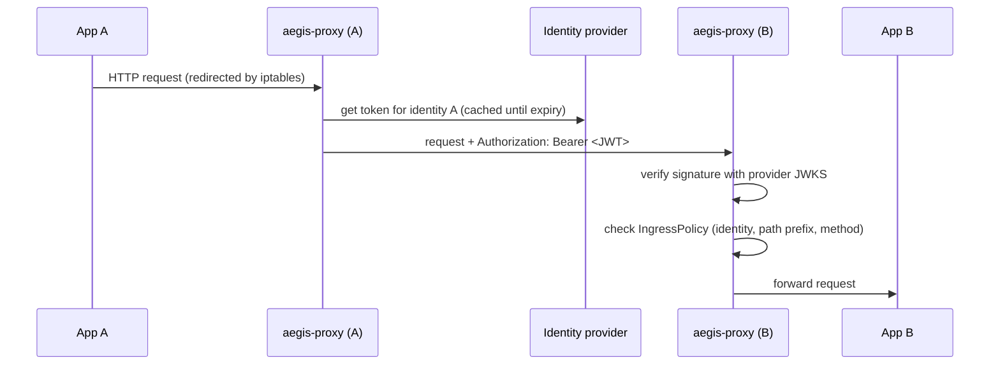

# aegis-proxy

`aegis-proxy` is the sidecar of [Aegis](https://github.com/vmarchese/aegis-operator), a Kubernetes service mesh that secures service-to-service traffic with JWT tokens issued by external identity providers instead of mTLS.

It runs next to the application container and handles both directions:

- **Egress:** it obtains a token for the pod's identity from the configured provider, caches it until it expires, and injects it as `Authorization: Bearer` into outgoing requests.
- **Ingress:** it validates the bearer token of incoming requests against the provider's public keys (JWKS) and enforces the pod's `IngressPolicy` before forwarding the request to the application.

The proxy is normally injected by the [aegis-operator](https://github.com/vmarchese/aegis-operator) mutating webhook, together with an init container that sets up the iptables rules redirecting traffic through it. It can also run standalone.

## How it works



## Identity providers

| Provider | Egress token | Ingress verification |
|---|---|---|
| HashiCorp Vault | Vault identity token, obtained by authenticating with the pod's service account token | Vault JWKS |
| Azure Entra ID | Kubernetes service account token federated with Entra ID | Entra ID JWKS |
| AWS IAM | Kubernetes service account token federated with AWS | AWS JWKS |
| Kubernetes | Projected service account token | Cluster issuer JWKS |

Providers implement a small interface (`GetToken`, `GetPublicKeys`), so adding a new one means adding a package under `internal/provider`.

## Ingress policies

When a policy name is set, the proxy reads the `IngressPolicy` custom resource from its own namespace and watches it, so changes apply without restarting the pod. Each rule lists:

- the **identities** allowed (matched against the token subject);
- the **path prefixes** the rule applies to;
- the **HTTP methods** allowed on those paths.

Requests without a valid token, with an unknown key ID or blocked by the policy are rejected with `401`.

## Running

```
aegisproxy run [flags]
```

| Flag | Default | Description |
|---|---|---|
| `-t, --type` | `ingress` | `ingress`, `egress` or `ingress-egress` |
| `-i, --inport` | `3127` | Ingress listener port |
| `-o, --outport` | `3128` | Egress listener port |
| `-p, --identity-provider` | `hashicorpvault` | Identity provider type |
| `-n, --identity` | `aegisproxy` | Identity used for outgoing requests |
| `--identity-allowed` | | Identities accepted on ingress |
| `-l, --policy` | | Name of the `IngressPolicy` to enforce |
| `-k, --token` | `/var/run/secrets/tokens/token` | Path of the projected service account token |
| `-g, --token-grace-period` | `1m` | Renew the token this long before it expires |
| `-a, --vault-address` | `http://127.0.0.1:8200` | Vault address |
| `--azure-tenant-id`, `--azure-client-id` | | Entra ID settings |
| `--aws-region`, `--aws-identity-id` | | AWS settings |
| `--kubernetes-issuer` | | Kubernetes token issuer |

When injected by the operator, these flags are set from pod annotations (`aegisproxy.io/egress`, `aegisproxy.io/ingress`, `aegisproxy.io/identity`, `aegisproxy.io/ingress.port`, `aegisproxy.io/ingress.policy`). See the operator docs for complete examples with [Vault](https://github.com/vmarchese/aegis-operator/blob/main/docs/hashicorpvault-example.md), [Entra ID](https://github.com/vmarchese/aegis-operator/blob/main/docs/azure-example.md), [AWS](https://github.com/vmarchese/aegis-operator/blob/main/docs/aws-example.md) and [Kubernetes](https://github.com/vmarchese/aegis-operator/blob/main/docs/kubernetes-example.md).

## Observability

Every proxied request produces an OpenTelemetry span with the proxy type, identity, namespace and caller subject, and trace context is propagated to the upstream service. Exporters are configured through the standard `OTEL_*` environment variables (OTLP over gRPC or HTTP).

## Building

```
make image
```

builds a static Go binary (Go 1.23) into an Alpine image. Version, Go version, build user and build time are embedded at build time.

## Status

Experimental. Built to explore workload identity for Kubernetes in multi-hybrid-cloud environments.
